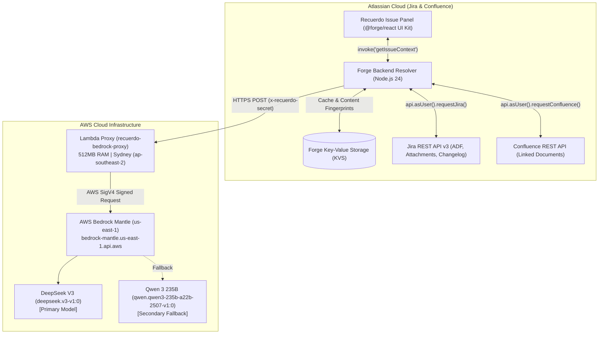

# Recuerdo — AI Decision Intelligence for Jira

> **Hackathon Edition** | Built on Atlassian Forge Cloud & AWS Bedrock Mantle

**Recuerdo** ("Memory") is a native Atlassian Forge app that brings transparent, cited AI decision intelligence directly to Jira issue panels. When an engineer, product manager, or support lead opens a resolved or in-progress issue, Recuerdo answers the critical question: ***"Why was this decision made?"***

Instead of skimming 40 comments, digging through attachments, or hunting for linked Confluence RFCs, Recuerdo synthesizes the resolution in seconds with clickable, color-coded inline citations.

---

## 🏛 Architecture Overview



---

## ✨ Key Features & Innovations

### 1. Multi-Source Ingestion & Analysis
Recuerdo does not rely on comments alone. It correlates 5 distinct data streams:
- 🟢 **Issue Description:** Initial problem statement and bug reports.
- 🔵 **Comments:** Engineer discussion, investigation notes, and debate.
- 🟠 **Attachments:** Uploaded logs, configuration diffs, and screenshot evidence.
- 🟣 **Status Changelog:** Exact timestamps and author transitions (e.g. who transitioned to *Fixed* or *Done* and when).
- 🐬 **Confluence Pages:** Automatically detects linked Confluence architecture specs and RFCs, retrieving clean text summaries via the Confluence REST API.

### 2. Interactive Inline Citation Pills
Every factual claim generated by the AI is tagged with a color-coded citation pill (e.g., `[1]`, `[2]`).
- **Adjacent Marker Merging:** Consecutive markers like `[1][2]` automatically merge into a single compound badge to avoid UI clutter.
- **Deep-Linking Modals:** Clicking any citation pill opens an inspection modal displaying the source quote, the AI's reason for citing it, and a direct link (*"View in Jira"* or *"View in Confluence"*).

### 3. Dynamic Source Filtering
Teams have full control over what feeds the AI. The **Sources** filter popup allows engineers to selectively toggle any combination of source types (e.g., exclude general comments and analyze only Status History + Confluence Specs).

### 4. 32-Bit Content Fingerprinting & Zero-Waste Caching
To eliminate wasteful LLM invocations and protect team quotas, Recuerdo implements a lightweight 32-bit rolling hash across all issue contents, comments, attachments, and transitions.
- **Instant Loads:** Unchanged tickets are served from Forge KVS storage in < 50ms.
- **Smart Invalidation:** Modifying a description, adding a comment, or uploading a file instantly invalidates the fingerprint, giving users fresh insights upon clicking **Refresh**.

### 5. Long-Thread Windowing & Budget Protection
On issues with 30–100+ comments, Recuerdo applies intelligent head/tail windowing:
- Preserves the first 5 comments (initial triage / root cause discovery).
- Inserts a citable note for omitted intermediate discussion.
- Preserves the last 15 comments (PR merges, deployment confirmations, and verification).
- Truncates oversized comments (> 1,200 chars) to prevent pasted stack traces from blowing the token budget.

### 6. 100% AWS Bedrock Mantle Backend
- Bypasses standard Bedrock daily token caps by communicating directly with **AWS Bedrock Mantle** (`us-east-1`) via AWS SigV4 signed requests.
- **Sub-2s warm latency** powered by **DeepSeek V3** (`deepseek.v3-v1:0`).
- Seamless automatic failover to **Qwen 3 235B** (`qwen.qwen3-235b-a22b-2507-v1:0`).

---

## 🧪 Automated Testing & Quality Assurance

Recuerdo includes a built-in automated test suite covering all core business logic:

```bash
# Run unit tests
npm test

# Run code linter
npm run lint
```

**Test Coverage (23 Automated Tests):**
- ✔ Content fingerprint generation & change detection (edits, additions, status changes, attachments, Confluence docs).
- ✔ Citation grouping parser (grouping `[1][2]`, handling whitespace, preserving delimiters).
- ✔ Comment thread windowing (50-comment threads, truncation limits).
- ✔ Attachment and status changelog sources extraction.
- ✔ Confluence URL parser and page ID extractor.
- ✔ Empty ticket resilience.

---

## 🚀 Deployment & Installation

### Prerequisites
- Node.js 22.x or 24.x
- Atlassian Forge CLI (`npm install -g @forge/cli`)
- Configured Forge environment variables:
  ```bash
  forge variables set --encrypt LAMBDA_PROXY_URL "<your-lambda-function-url>"
  forge variables set --encrypt LAMBDA_PROXY_SECRET "<your-shared-secret>"
  ```

### Build & Deploy
```bash
# Deploy to development
forge deploy -e development

# Install or upgrade on your Jira site
forge install --upgrade --site <your-domain>.atlassian.net --product jira --environment development
```

---

## 📄 License
MIT License. Created for the Atlassian Forge Hackathon.
